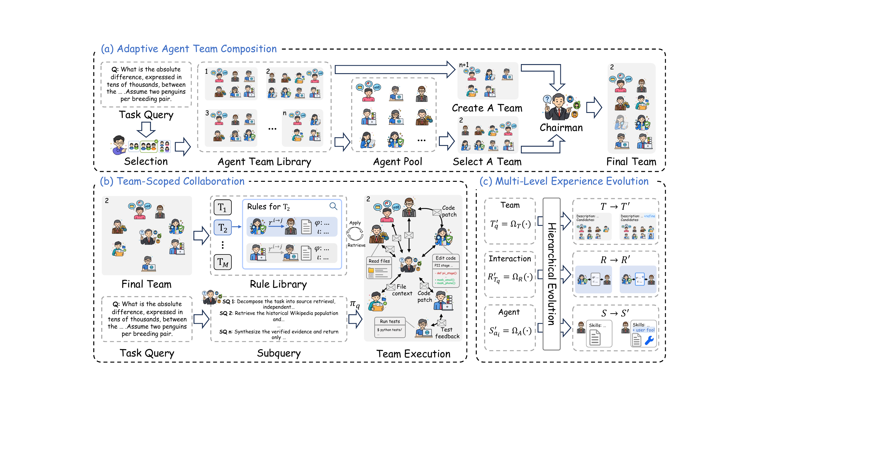

# EvoTeam: Multi-Agent Collaboration via Evolving Teams

This repository contains the clean implementation of the EvoTeam mixed-benchmark
evaluation pipeline. It provides a shared agent pool, team formation,
team-scoped handoff rules, and post-task experience evolution.

<p align="center">
  
</p>

## Overview

EvoTeam treats a multi-agent system as an evolving team. For each task, the
system selects a reusable team or composes a provisional team from the global
agent pool. The Chairman recruits and coordinates the execution team. Execution
evidence and task feedback then update team organization, team-scoped handoff
rules, and reusable agent skills.

| Module | Role |
|---|---|
| Adaptive Agent Team Composition | Select a compatible reusable team or compose a provisional team, then recruit task-specific members. |
| Team-Scoped Collaboration | Provide the selected team's handoff rules as soft coordination guidance during execution. |
| Multi-Level Experience Evolution | Use task evidence to evolve team descriptions, candidate rosters, handoff rules, and agent skills. |

The framework separates team collaboration experience from reusable agent
capability experience: team templates and handoff rules remain team-scoped,
while individual skills can be reused across teams.

## Installation

Requirements:

- Python >= 3.10
- Docker for BeyondSWE tasks
- External benchmark data listed in [Data Preparation](#data-preparation)
- A compatible tool package prepared as described in [Tool Setup](#tool-setup)
- An OpenAI-compatible or supported LLM endpoint

Create a virtual environment and install the package:

```bash
cd EvoTeam
python3 -m venv .venv
source .venv/bin/activate
python3 -m pip install --upgrade pip
python3 -m pip install -e .
```

Create a private environment file from the template and configure the model
endpoint. Keep credentials, datasets, external tools, run outputs, and caches
out of version control.

```bash
cp .env.example .env
```

For an OpenAI-compatible endpoint, configure:

```dotenv
LLM_PROVIDER=dev
DEV_API_BASE=https://your-openai-compatible-endpoint/v1
DEV_API_KEY=your-api-key
EVOTEAM_MODEL=your-model-id
```

The runtime reads the repository-root `.env` file. To use another configuration
file, set its path before starting the runtime:

```bash
export EVOTEAM_ENV_FILE="/absolute/path/to/evoteam.env"
```

Manifest-only validation does not require benchmark payloads. Native execution
also requires the corresponding benchmark services and, for BeyondSWE, Docker.

## Configuration

The shared pool and main configuration files are:

- `agents/pool_EvoTeam/`: shared agent pool and constitution.
- `agents/pool_EvoTeam/pool.yaml`: pool membership and orchestration settings.
- `agents/pool_EvoTeam/*/config.yaml`: model and agent settings.
- `agents/pool_EvoTeam/constitution.md`: shared team constitution.
- `.env`: private model endpoint configuration.
- `benchmarks/MIXED-BENCHMARK/manifests/*.json`: task ordering and benchmark bindings.

The official mixed evolution manifest is
`benchmarks/MIXED-BENCHMARK/manifests/mixed_benchmark_official_116_seed20260828.json`.
Its fixed global-shuffle seed is `20260828`, and its order hash is
`b6784c5eeec9b23061b8c28fb7ff52c9297a4ba9185e7d393283314acaace87e`.

The manifest applies evolution updates sequentially over one shared mixed-task
stream. Individual-benchmark experiments use separate evolution streams and do
not share experience across tracks.

## Data Preparation

Dataset payloads and external tool implementations are not bundled. Prepare
the following splits locally:

| Benchmark / track | Evolution | Holdout | Native metric |
|---|---:|---:|---|
| GAIA | 20 | 100 | Official answer pass rate |
| LoCoBench FI | 20 | 80 | LoCoBench Score (LCBS) |
| LoCoBench CR | 20 | 80 | LoCoBench Score (LCBS) |
| LOCA-Bench | 16 | 240 | Native final-state success rate |
| BeyondSWE CrossRepo | 20 | 180 | Resolved-instance rate |
| BeyondSWE DepMigrate | 20 | 158 | Resolved-instance rate |
| **Total mixed stream** | **116** | **838** | Source-native metrics |

Obtain the benchmark data from the official project sources:

- [GAIA](https://huggingface.co/datasets/gaia-benchmark/GAIA)
- [LoCoBench](https://github.com/SalesforceAIResearch/LoCoBench)
- [LOCA-Bench](https://github.com/hkust-nlp/LOCA-Bench)
- [BeyondSWE](https://github.com/AweAI-Team/BeyondSWE)

By default, benchmark assets are resolved relative to the repository root:

```text
EvoTeam/
├── tools/
├── data/
│   └── gaia/
│       ├── level_1_train_20.json
│       ├── level_2_train_20.json
│       ├── level_3_train_20.json
│       ├── level_1_test_100.json
│       ├── level_2_test_100.json
│       ├── level_3_test_100.json
│       └── val_files/
└── benchmarks/
    ├── LoCoBench/
    │   ├── locobench/
    │   └── data/
    │       ├── output/scenarios/
    │       └── generated/
    ├── LOCA-bench/
    │   ├── task-configs/
    │   ├── inference/
    │   ├── gem/
    │   └── mcp_convert/
    └── BeyondSWE/
        └── beyondswe.jsonl
```

GAIA requires the prepared split files and corresponding attachments.
Downloading the original dataset alone does not create the split files
expected by this implementation. LoCoBench requires both its dataset and
evaluation code. LOCA-Bench requires its task configurations, environment
implementation, and MCP server dependencies.

To store these assets outside the repository, configure an external root
before launching:

```bash
export MIXED_DATA_ROOT="/absolute/path/to/external-assets"
```

Preserve the same `data/` and `benchmarks/` layout under that root. The mixed
scheduler also checks for `tools/` under the external root, so provide the
compatible package there as well. Both locations can link to the same tool
directory. The runtime still requires `tools/` at the repository root.

BeyondSWE also supports an explicit dataset path:

```bash
export BEYONDSWE_DATA_FILE="/absolute/path/to/beyondswe.jsonl"
```

## Tool Setup

EvoTeam requires a compatible Python package named `tools`. This package
provides execution tools, agent communication, orchestration primitives, and
reflection operations. Installing the Python dependencies alone does not
install this package.

### Prepare the tool package

Place the tool implementation directory at the repository root:

```text
EvoTeam/
├── tools/
│   ├── __init__.py
│   ├── bash.py
│   ├── read_file.py
│   ├── write_file.py
│   ├── web_search.py
│   ├── web_fetch.py
│   ├── docker_bash.py
│   ├── docker_str_replace_editor.py
│   ├── loca_mcp.py
│   ├── messaging.py
│   ├── primitives.py
│   └── reflection.py
├── core/
├── benchmarks/
└── runtime_pool.py
```

From the repository root, copy an existing compatible tool package:

```bash
cp -R "/path/to/compatible/tools" ./tools
```

Alternatively, link to an existing directory:

```bash
ln -s "/path/to/compatible/tools" ./tools
```

Use either command when `./tools` does not already exist. The runtime loads
execution tools from this directory. Setting `MIXED_DATA_ROOT` does not
replace this requirement.

### Tool groups

| Group | Modules | Purpose |
|---|---|---|
| Local execution | `bash`, `read_file`, `write_file` | Execute commands and access task workspace files. |
| Web access | `web_search`, `web_fetch` | Search the web and retrieve webpage text. |
| Container execution | `docker_bash`, `docker_str_replace_editor` | Run commands and edit files inside BeyondSWE containers. |
| LOCA environment | `loca_mcp` | Access the MCP tools initialized for each LOCA-Bench task. |
| Agent communication | `messaging` | Exchange messages, wait for replies, and inspect agent status. |
| Orchestration | `primitives` | Provide agent lifecycle and task submission operations. |
| Reflection | `reflection` | Provide prompt patch, skill, and teammate profile update operations. |

Teammate Profile Reflection maintains the Chairman's recruitment memory.
It is separate from team-template and handoff-rule evolution. The external
tool package's legacy `skip_l2_reflection` tool and internal `l2_reflection`
protocol remain for compatibility; these names refer to profile maintenance.

The benchmark-specific execution tools are:

| Benchmark | Execution tools |
|---|---|
| GAIA | `read_file`, `write_file`, `bash`, `web_search`, `web_fetch` |
| LoCoBench | `read_file`, `write_file`, `bash` |
| LOCA-Bench | `read_file`, `write_file`, `bash`, `loca_mcp` |
| BeyondSWE | `read_file`, `docker_bash`, `docker_str_replace_editor` |

Communication, orchestration, and reflection modules support the shared
runtime across benchmarks. Individual benchmarks may require additional
dependencies from their own installation instructions.

### Configure web search

The compatible web search implementation selects a provider in this order:

1. Serper when `SERPER_KEY_ID` is configured.
2. SerpAPI when `SERPAPI_API_KEY` is configured.
3. DuckDuckGo when neither key is configured.

To use Serper, add the following to `.env`:

```dotenv
SERPER_KEY_ID=your-serper-api-key
```

Alternatively, use SerpAPI:

```dotenv
SERPAPI_API_KEY=your-serpapi-api-key
```

DuckDuckGo does not require an API key. Web search and webpage retrieval
require network access.

### Additional runtime requirements

BeyondSWE requires a running Docker daemon and access to the container images
used by its tasks. Check Docker availability with:

```bash
docker info
```

For LOCA-Bench, install the dependencies required by the task-configured MCP
servers. The adapter initializes the environment and MCP tools for each task;
`loca_mcp` becomes available through that initialization.

### Verify tool loading

Run this check from the repository root:

```bash
python3 -B - <<'PY'
import importlib
from pathlib import Path
from core.tool_registry import ToolRegistry

required = {
    "bash",
    "read_file",
    "write_file",
    "web_search",
    "web_fetch",
    "docker_bash",
    "docker_str_replace_editor",
    "loca_mcp",
}

registry = ToolRegistry(str(Path("tools").resolve()))
missing = required - set(registry.all_names())
if missing:
    raise SystemExit(f"Missing execution tools: {sorted(missing)}")

for name in ("messaging", "primitives", "reflection"):
    importlib.import_module(f"tools.{name}")

print("Tool package loaded successfully.")
PY
```

This check verifies module imports and execution tool registration. Benchmark
data, API access, Docker images, and MCP services must be configured separately.

## Evolution and Evaluation

The experimental lifecycle is:

```text
Evolve -> Freeze -> Evaluate
```

### Evolution

Validate and preview the fixed 116-case evolution stream:

```bash
python3 benchmarks/MIXED-BENCHMARK/validate_manifest.py \
  benchmarks/MIXED-BENCHMARK/manifests/mixed_benchmark_official_116_seed20260828.json

python3 benchmarks/MIXED-BENCHMARK/mixed_scheduler.py \
  --manifest benchmarks/MIXED-BENCHMARK/manifests/mixed_benchmark_official_116_seed20260828.json \
  --phase evolve --dry-run
```

Run evolution with a chosen run ID:

```bash
python3 benchmarks/MIXED-BENCHMARK/mixed_scheduler.py \
  --manifest benchmarks/MIXED-BENCHMARK/manifests/mixed_benchmark_official_116_seed20260828.json \
  --phase evolve --run-id <evolution_run_id>
```

Use `--max-tasks N` for a smoke run and `--resume` to continue an interrupted
run.

### Freeze and evaluation

Copy the final team version to a separately named frozen pool and evaluate it
on the disjoint holdout manifest:

```bash
mkdir -p agents/pool_EvoTeam_frozen
cp -R runs/<evolution_run_id>/team/<final_version>/. agents/pool_EvoTeam_frozen/

python3 benchmarks/MIXED-BENCHMARK/mixed_scheduler.py \
  --manifest benchmarks/MIXED-BENCHMARK/manifests/mixed_benchmark_official_116_plus_838_test_seed20260828.json \
  --phase test --team pool_EvoTeam_frozen --run-id <test_run_id> --rollout 3

python3 scripts/aggregate_avg3.py \
  <test_run_id>_r1 <test_run_id>_r2 <test_run_id>_r3
```

The test phase is read-only with respect to the frozen team. We report avg@3,
averaging three independent rollout scores per test instance.

The reported metrics are exact normalized answer accuracy for GAIA, LCBS for
LoCoBench, final-state success for LOCA-Bench, and resolved-instance rate for
BeyondSWE. Per-case resource budgets are:

| Benchmark | Maximum time | Maximum messages | Maximum cost |
|---|---:|---:|---:|
| GAIA | 900 s | 300 | $2.40 |
| LoCoBench | 1800 s | 400 | $2.40 |
| BeyondSWE | 1800 s | 600 | $2.40 |
| LOCA-Bench | 3200 s | 600 | $12.00 |

Unless an experiment states otherwise, use `GPT-5.6-Luna`, temperature `0.2`,
and maximum output length `32768` tokens for execution and applicable
reflection calls.

## Project Structure

```text
EvoTeam/
├── agents/pool_EvoTeam/              # Shared agent pool and constitution
├── core/                              # Runtime, formation, reflection, persistence
├── benchmarks/
│   ├── MIXED-BENCHMARK/               # Manifest, scheduler, and mixed facade
│   ├── mixed_native/                  # Native GAIA, LoCoBench, LOCA, BeyondSWE backends
│   └── adapter.py                     # Shared benchmark execution bridge
├── prompts/                           # Bootstrap and reflection prompts
├── scripts/                           # Manifest, freeze, and aggregation utilities
├── assets/                            # Framework overview figure
├── tests/                             # Structural and reflection behavior tests
├── runtime_pool.py                    # Runtime pool entry point
├── pyproject.toml                     # Package metadata and dependencies
├── requirements.txt                   # Installable dependency list
└── README.md
```

The backend files under `benchmarks/mixed_native/` preserve each benchmark's
task construction, environment setup, output contract, and native evaluation,
while the shared evolution logic remains in `core/`.

## Citation

If you use this code, cite the accompanying paper:

```text
EvoTeam: Multi-Agent Collaboration via Evolving Teams.
```
